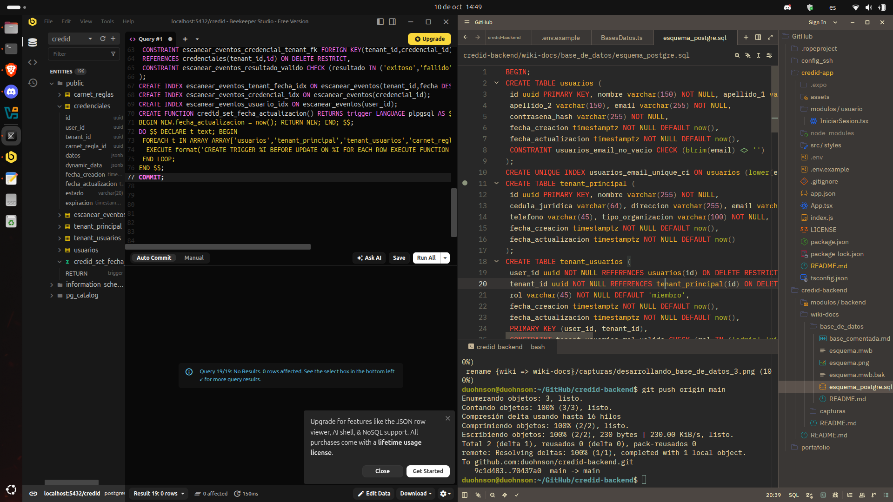

Wiki-docs.

Bases de datos: [https://github.com/duohnson/carnetify-backend/wiki-docs/base_de_datos/README.md](https://github.com/duohnson/carnetify-backend/wiki-docs-docs/base_de_datos/README.md)

(Las capturas pueden aparecer con CREDID, que era su antiguo nombre, ya que por recomendación se modifico a uno más enfocado a la necesidad que cubre el sistema, CREDID tenia un sonar a credito, financiero, y no, no es el enfoque, por eso se mudo a CARNETIFY!)

Actual esquema: 

Actual base: 

¿Donde realizo mis diagramas? - Bueno eso depende del lenguaje, para SQL uso MySQL Workbench, y para PostgreSQL uso el mismo pero lo transcribo en https://dbdiagram.io/d
