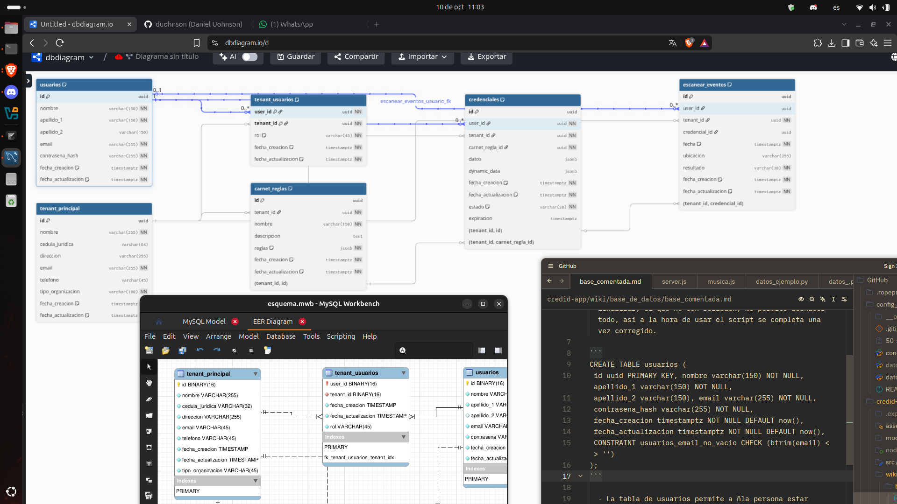

Wiki.

Bases de datos: [https://github.com/duohnson/credid-backend/wiki/base_de_datos/README.md](https://github.com/duohnson/credid-backend/wiki/base_de_datos/README.md)

Actual esquema: 
(En desarrollo)

¿Donde realizo mis diagramas? - Bueno eso depende del lenguaje, para SQL uso MySQL Workbench, y para PostgreSQL uso el mismo pero lo transcribo en https://dbdiagram.io/d
